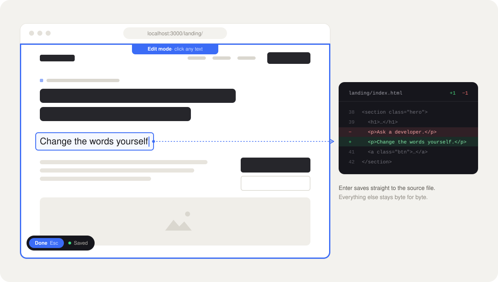
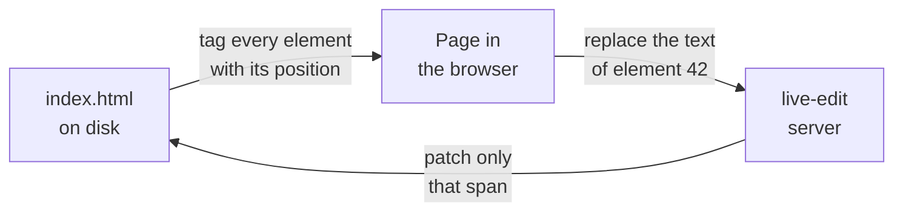

<div align="center">

# live-edit

**Click the text on your page. Type. It's saved in the HTML file.**

A tiny local server that turns any static HTML site into an editable page,
and writes every change straight back into the source, one element at a time.

</div>

<br>



<br>

## Why

Static sites are fast, cheap to host and last forever. The catch is copy: every
typo, every new headline, every "can we say *five days* instead of *a week*?"
goes back to whoever knows where the HTML lives.

live-edit removes that step. Whoever owns the words opens the page, presses
**Edit**, and fixes it on the page itself, in the real layout, with the real
fonts. What lands in the repo is a one-line diff in the file you'd have edited
by hand.

No CMS, no database, no build step, no account. The site stays a folder of HTML.

## Will it work on my site?

Take a sentence you'd like to change, open your `.html` files in a code editor
and search for it.

- **Found it, as plain text in an `.html` file?** live-edit will work.
- **Found it in a `.jsx`, `.tsx`, `.vue`, `.svelte`, `.md` or `.mdx` file, or in a CMS?** It won't. The HTML your browser shows is generated, so there's no file for live-edit to patch.
- **Found it only inside a `dist/`, `build/` or `out/` folder?** It will look like it works, but your next build will overwrite every change. Don't use it there.

You also need:

- **Node.js 22.18 or newer.** Check with `node --version`, get it from [nodejs.org](https://nodejs.org).
- **git**, because `npx` downloads live-edit straight from this repository.

Tested on macOS. Linux should work the same; Windows hasn't been tried yet.

## Use it on your site

**1. Start it** from the folder of your site:

```bash
cd my-site
npx github:lucadebort/live-edit#v0.1.0 . --open
```

The first run downloads and builds live-edit, which takes a minute. After that it
starts in a second. Your browser opens on the site, served from
`http://localhost:3000`.

Instead of `.` you can pass a single page (`about.html`) or a folder (`landing`),
and only that becomes editable. See [below](#make-only-part-of-a-site-editable).

**2. Edit.** Press **Edit** in the bottom left corner (or `Alt+E`), click any text and type.

| Key | |
| --- | --- |
| `Enter` | Save |
| `Shift+Enter` | Line break |
| `Escape` | Cancel |
| `Alt+E` | Toggle edit mode |

Click an image to replace it with a file from your computer. The new file is
copied into an `uploads/` folder next to the page.

**3. Commit.** Every save is already in your `.html` files, so `git diff` shows
exactly what changed. Commit and push the way you always do, including the
`uploads/` folder if you replaced images. live-edit never commits, pushes or
deploys anything for you.

Stop the server with `Ctrl+C` in the terminal.

## Make only part of a site editable

Point live-edit at the page or folder people are allowed to touch, and use
`--root` to serve the whole site around it:

```bash
npx github:lucadebort/live-edit#v0.1.0 landing --root . --open
```

The full site loads as usual, with its shared `/assets`, but the Edit button
only appears on pages inside `landing/`. Everywhere else the server refuses to
save, even if someone calls it directly.

You need `--root` whenever your pages load files with absolute paths
(`/assets/style.css`). Without it, live-edit serves only the `landing` folder and
those files come back as 404s, so the page shows up unstyled.

## Share it with your team

Commit a small script to the site's repo, so nobody has to remember the command:

```bash
#!/bin/bash
# edit.sh: edit the landing page in the browser
cd "$(dirname "$0")"
exec npx --yes github:lucadebort/live-edit#v0.1.0 landing --root . --open "$@"
```

Make it executable once with `chmod +x edit.sh`, and from then on a teammate
runs `./edit.sh`. The `#v0.1.0` at the end pins the version, so an update
here never changes things under their feet. Bump it when you want the new one.

If you deploy by uploading a folder, check that your deploy script skips
`edit.sh`. It's harmless on a server, but it doesn't belong there.

## Options

| Option | Default | |
| --- | --- | --- |
| `-r, --root <dir>` | the page's folder | Folder served as the site root. Only the target stays editable |
| `-s, --scope <css>` | none | Only elements inside this selector are editable, e.g. `main` |
| `-u, --uploads <dir>` | `uploads` | Where replaced images go, relative to the page |
| `-p, --port <n>` | `3000` | Uses the next free port if it's taken |
| `-o, --open` | off | Opens the browser |

## How it works



live-edit never saves the page as the browser sees it. When it serves an HTML
file it tags every element that exists in the source with an id (its position
in the file) and injects the editor. An edit is sent as *replace the content of
element 42*, and the server patches exactly that span. That means:

- **The rest of the file stays byte for byte as it was.** Formatting, comments, inline styles, attribute order.
- **What the page's JavaScript does never leaks into the source.** Classes added at runtime, generated elements, sliders, cookie banners.
- **Nested markup survives.** A `<br>` or an `<em>` inside an edited heading keeps its tags.

### Safe by default

- **No silent overwrites.** Every save checks a hash of the file. If it changed on disk in the meantime (you edited it in your editor, or pulled), the save is refused and the page asks you to reload.
- **Backups outside your project.** Before each save the previous version goes to `~/.cache/live-edit/`, last 20 per file. Your repo stays clean.
- **Local only.** The server listens on `127.0.0.1` and nothing else, since it writes to disk.
- **Iframes included.** Same-origin iframes are served the same way, so embedded pages are editable and saved to their own files.

## Good fit, bad fit

live-edit is built for one kind of site, on purpose.

| Works great | Doesn't work |
| --- | --- |
| Hand-written HTML and CSS sites | React, Next.js, Vue, Svelte, Astro output |
| Landing pages, portfolios, microsites | Pages rendered from MDX, Markdown or a CMS |
| HTML slide decks and one-pagers | Text that JavaScript creates at runtime |
| Sites deployed by uploading a folder | Anything that needs a build step to show the change |

If what you see in the browser is generated, there is no single spot in an HTML
file to patch, so live-edit can't help.

A few more limits worth knowing:

- **Text only.** Bold, links and new elements still go through your code editor.
- **`<picture>` sources.** Replacing an image changes the `` only. If the page has `<source>` elements (WebP, AVIF), the browser keeps showing those until you update them too.
- **Saving is not publishing.** live-edit writes the file. Committing, pushing and deploying stay your call.

## When something doesn't work

**I click the text and nothing happens.**
Check that edit mode is on (the **Edit** button is blue). If it is, that text
isn't in your HTML file: the page's JavaScript created it, or it comes from a
framework. See [Will it work on my site?](#will-it-work-on-my-site)

**There's no Edit button on the page.**
The page is outside what you made editable. If you started live-edit with a
folder or a page plus `--root`, only that folder or page gets the button.

**The page loads without styles or images.**
Your site uses absolute paths like `/assets/...`. Start live-edit from the
site's root folder, or add `--root .` (or `--root` plus the path to it).

**"The file changed on disk. Reload the page."**
The file was modified after the page loaded: in your editor, by a `git pull`,
or by a teammate on a shared folder. live-edit refuses to save so it doesn't
overwrite that change. Reload and redo your last edit.

**I replaced an image but the old one still shows.**
The image sits inside a `<picture>` with `<source>` elements (WebP, AVIF), and
the browser prefers those. Update or remove the `<source>` lines in your code
editor.

**My changes disappeared after a build.**
You were editing generated files (`dist/`, `build/`, `out/`). The build writes
them again from the real sources, which live-edit can't reach.

**`npx` fails with a git or permission error.**
Make sure git is installed (`git --version`) and that you can reach github.com.

**`command not found: npx`, or errors about the Node version.**
Install or update Node.js from [nodejs.org](https://nodejs.org), version 22.18 or newer.

**Port 3000 is busy.**
Nothing to do: live-edit takes the next free port and prints the address in the
terminal. Use `--port` to pick one yourself.

**I want to undo a save.**
`git checkout -- page.html` brings back the last committed version. For earlier
saves in the same session, every previous version is kept in
`~/.cache/live-edit/`, last 20 per file.

## Development

```bash
npm install
npm run build      # compiles src/ to dist/
npm run typecheck
npm test           # patching logic, node:test
npm link           # makes `live-edit` available everywhere
```

TypeScript, one runtime dependency ([parse5](https://github.com/inikulin/parse5)).

<br>

<div align="center">
<sub>Made by <a href="https://www.nordlysdesign.it">Nordlys Design</a></sub>
</div>
