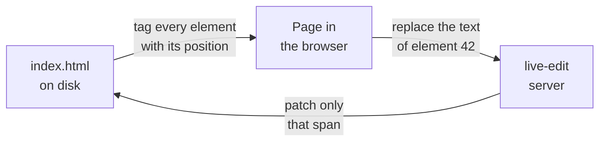

<div align="center">

# live-edit

**Click the text on your page. Type. It's saved in the HTML file.**

A tiny local server that turns any static HTML site into an editable page,
and writes every change straight back into the source, one element at a time.

</div>

<br>


<br>

## Why

Static sites are fast, cheap to host and last forever. The catch is copy: every
typo, every new headline, every "can we say *five days* instead of *a week*?"
goes back to whoever knows where the HTML lives.

live-edit removes that step. Whoever owns the words opens the page, presses
**Edit**, and fixes it on the page itself, in the real layout, with the real
fonts. What lands in the repo is a one-line diff in the file you'd have edited
by hand.

No CMS, no database, no build step, no account. The site stays a folder of HTML.

## Quick start

You need Node 22.18 or newer.

```bash
npx github:lucadebort/live-edit ./site --open
```

Then press **Edit** in the bottom left corner (or `Alt+E`), click any text and type.

| Key | |
| --- | --- |
| `Enter` | Save |
| `Shift+Enter` | Line break |
| `Escape` | Cancel |
| `Alt+E` | Toggle edit mode |

Click an image to replace it with a file from your computer.

## Make only part of a site editable

Point live-edit at the page or folder people are allowed to touch, and use
`--root` to serve the whole site around it:

```bash
live-edit landing --root .
```

The full site loads as usual, with its shared `/assets`, but the Edit button
only appears on pages inside `landing/`. Everywhere else the server refuses to
save, even if someone calls it directly.

A small script in the site's repo is all a teammate needs:

```bash
#!/bin/bash
cd "$(dirname "$0")"
exec npx --yes github:lucadebort/live-edit#v0.1.0 landing --root . --open
```

## Options

| Option | Default | |
| --- | --- | --- |
| `-r, --root <dir>` | the page's folder | Folder served as the site root. Only the target stays editable |
| `-s, --scope <css>` | none | Only elements inside this selector are editable, e.g. `main` |
| `-u, --uploads <dir>` | `uploads` | Where replaced images go, relative to the page |
| `-p, --port <n>` | `3000` | Uses the next free port if it's taken |
| `-o, --open` | off | Opens the browser |

## How it works



live-edit never saves the page as the browser sees it. When it serves an HTML
file it tags every element that exists in the source with an id (its position
in the file) and injects the editor. An edit is sent as *replace the content of
element 42*, and the server patches exactly that span. That means:

- **The rest of the file stays byte for byte as it was.** Formatting, comments, inline styles, attribute order.
- **What the page's JavaScript does never leaks into the source.** Classes added at runtime, generated elements, sliders, cookie banners.
- **Nested markup survives.** A `<br>` or an `<em>` inside an edited heading keeps its tags.

### Safe by default

- **No silent overwrites.** Every save checks a hash of the file. If it changed on disk in the meantime (you edited it in your editor, or pulled), the save is refused and the page asks you to reload.
- **Backups outside your project.** Before each save the previous version goes to `~/.cache/live-edit/`, last 20 per file. Your repo stays clean.
- **Local only.** The server listens on `127.0.0.1` and nothing else, since it writes to disk.
- **Iframes included.** Same-origin iframes are served the same way, so embedded pages are editable and saved to their own files.

## Good fit, bad fit

live-edit is built for one kind of site, on purpose.

| Works great | Doesn't work |
| --- | --- |
| Hand-written HTML and CSS sites | React, Next.js, Vue, Svelte, Astro output |
| Landing pages, portfolios, microsites | Pages rendered from MDX, Markdown or a CMS |
| HTML slide decks and one-pagers | Text that JavaScript creates at runtime |
| Sites deployed by uploading a folder | Anything that needs a build step to show the change |

If what you see in the browser is generated, there is no single spot in an HTML
file to patch, so live-edit can't help.

A few more limits worth knowing:

- **Text only.** Bold, links and new elements still go through your code editor.
- **`<picture>` sources.** Replacing an image changes the `` only. If the page has `<source>` elements (WebP, AVIF), the browser keeps showing those until you update them too.
- **Saving is not publishing.** live-edit writes the file. Committing, pushing and deploying stay your call.

## Development

```bash
npm install
npm run build      # compiles src/ to dist/
npm run typecheck
npm test           # patching logic, node:test
npm link           # makes `live-edit` available everywhere
```

TypeScript, one runtime dependency ([parse5](https://github.com/inikulin/parse5)).

<br>

<div align="center">
<sub>Made by <a href="https://www.nordlysdesign.it">Nordlys Design</a></sub>
</div>
